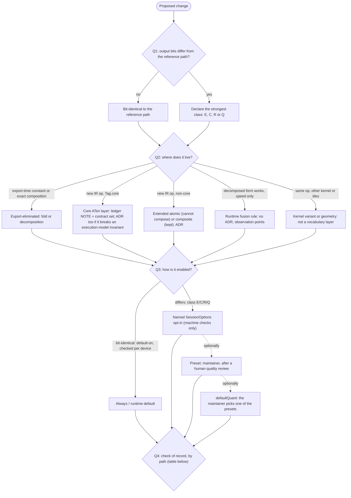

# Kernel, fusion and numerics rules: cheat sheet

This is a summary index of rules whose source of truth is the cited ADRs and docs; when this sheet and a source disagree, the source wins (point-in-time: 2026-11-10, after ADR [0147](decisions/0147-numerics-and-kernel-adoption.md) was accepted; line numbers in code cites are those of 2026-11-09 and drift).
The numerics rules are ADR 0147, which supersedes ADR 0058 and ADR 0110. Several of its rules wait for code changes filed in the [backlog](backlog.md); where the code still behaves the old way, this sheet says "pending".

Audience: anyone adding a kernel, a fusion rule, an IR op or a path that changes numbers.
RFC 2119 words (MUST / SHOULD / MAY) appear only where the source uses them; "by precedent" marks practice that no source requires.
Paths are repository-relative; `ADR nnnn dN` means decision N of `docs/decisions/nnnn-*.md`.

**Terms used below** (full list: `docs/glossary.md`)

| Term | Meaning | Source |
| --- | --- | --- |
| Reference path | The output of a Session built with every `SessionOptions` field omitted. It is frozen. "Default" in this sheet means this, never a distribution's `defaultQuant`. | ADR 0147 d1, d6 |
| Level (reference / practical / opt-in / preset) | The purpose and admission route of a path: reference = the reference path over the stored weights; practical = what browser execution needs (storage quantization, a8, s16, f16 state); opt-in = speed by reordering (R), approximation (Q) or f16 compute (c16); preset = a configuration the maintainer checked. A separate axis from the contract class | ADR 0147 d1 |
| Practical preset | A quant preset whose manifest `session` is non-empty (a sha row class and the self A/B side). Not the same as the practical level: a preset that declares an R or Q option is a practical preset, yet the option is opt-in level | ADR 0147 d1, d11 |
| Preset / `session` / `defaultQuant` | A named entry in a distribution manifest (`quants.<name>`); its `session` holds option values; `defaultQuant` names the one used when the caller names none | ADR 0128 d1; `packages/hub/src/manifest.ts:173-200, 370` |
| Contract class (E / C / R / Q) | How a numerics-changing variant proves its numbers (section 2) | ADR 0147 d2 |
| Layer / entry door | A layer is one place a computation can live (section 3; `docs/op-vocabulary.md` calls its table "Door"). The entry door is the single Core ATen test (`Tag.core`) that decides whether an op needs an ADR. | `docs/glossary.md:56-59`; ADR 0059 d2 |
| Ledger NOTE | A dated entry for an op in `docs/op-vocabulary.md` (the op ledger) | ADR 0059 d2 |
| Contract set | Landed together: `OP_CONTRACTS` (TS), Python `ops.py` / `shapes.py`, `fixtures/op-contracts.json`, CPU reference, golden `COVERAGE` | ADR 0059 d7; ADR 0007 |
| Fusion rule / annotation | A plan-time matcher in `packages/runtime/src/runtime/fusion-rules/` that replaces nodes with a private kernel (a `FusedStep`); an annotation instead lets a consumer kernel absorb its producer (linear prologue, attention permutes) | ADR 0040 d1, addenda 2026-10-25, 2026-10-26 |
| Rounding barrier | A kernel technique that keeps each rounding point of the unfused chain, so the compiler cannot contract across it | ADR 0040 d2; ADR 0099 d2 |
| Twin-graph test | GPU test comparing a fused Session with the same graph made unmatchable: u32 equality for finite values, NaN by class | ADR 0040 addendum 2026-09-12; `packages/runtime/tests/gpu_gated_residual_fusion_test.ts:65-72` |
| Four-point check | (1) band vs f64, (2) A/B band vs the reference path, (3) exact structural checks, (4) a recorded fault injection that turns (1) or (2) red | ADR 0147 d2 |
| E2E self A/B (five items) | Census, difference floor, collapse ceiling, observation point, fault injection per check (section 4c) | ADR 0147 d2 |
| Census | Check that the selected variant really ran, read from `SessionDiagnostics.lastRunPipelines` (`packages/runtime/tests/helpers/pipeline-census.ts`); the census *table* (`packages/models/tests/helpers/census-table.ts`) lists which presets the E2E checks cover | ADR 0147 d2 |
| Pipeline key | Per-dispatch kernel key in diagnostics; a fallback or a device switch shows in it (`:dp4aEmu`) | ADR 0147 d8 |
| Session canary | At Session construction, each default-on fusion and its unfused form on the same input, compared as u32; on a mismatch the runtime warns and drops that fusion (pending) | ADR 0147 d9 |
| Applicability check | The admission-time decision, per receiving Session and per (key, value), whether an option has a place in the graph or is structurally impossible; replaces the per-family acceptance tables (pending) | ADR 0147 d7 |
| Device-capability switch | A defined move to another path when the adapter lacks a feature, warned once per device and shown in the pipeline key (pending) | ADR 0147 d8 |
| sha row / environment key | A tracked sha256 of an output per environment key `<runtime>-<adapter slug>`: `node-<device>` for the Node lanes; browser records use other bases (for example `chrome-apple-metal-3`) | ADR 0106 d1-d2; ADR 0127 |
| Reference guard | End-of-file check that every registered case has a sha row for this machine or is held | ADR 0106 d4, addendum 2026-10-03 |
| Lane | A Vitest project from `packages/test-support/src/lanes.ts` (`core`, `models:<family>`) | ADR 0129 d2 |
| Geometry profile / adapter class | A static, generated table of tile geometries; it is matched on the adapter class, the `(vendor, architecture[, description])` of `GPUAdapterInfo` | ADR 0115 d1-d2, addendum d7 |

## 1. Decision flow

| Question | Answer options | Source |
| --- | --- | --- |
| Q1. Does the change alter output values against the reference path? | No: bit-identical. Yes: declare the strongest class that can be built (E, C, R, Q); the ADR states why a stronger class cannot be built (MUST). | ADR 0147 d2; ADR 0040 d2 |
| Q2. Where does it live? | Export-eliminated / Core ATen layer / extended atomic or composite layer / runtime fusion rule; kernel variants and geometry are outside the vocabulary layers. Try the layers top down. | `docs/op-vocabulary.md:147-226`; ADR 0059 d1-d6; ADR 0064 d2 |
| Q3. How is it enabled? | Always (export-time rewrites, default-on fusions, codegen) / runtime default (automatic choice between identical variants only with a machine check on that device) / named `SessionOptions` opt-in (admitted on machine checks only) / preset (`quants.<name>.session`, the maintainer's decision after a human quality review) / `defaultQuant` (the maintainer picks one of the presets). A fusion bit-identical to the unfused plan runs without an option and is checked per device by the Session canary; the three boolean fusion keys (`fuseRmsNormAdd`, `fuseLinearStaticQuantize`, `fuseGeluMulStaticQuantize`) are removed (pending). Opt-in, preset and `defaultQuant` are alternative end states, not a pipeline. | ADR 0147 d3, d5, d6, d9; ADR 0128 d1 |
| Q4. What is the check of record? | Fusion rule: twin-graph test + unchanged sha rows on the development machine, the Session canary on every device (pending) and `/kernel-check` per backend before every release. Geometry or profile: sweep `identicalToDefault` + per-profile Uint32 GPU test + re-run sha checks (MUST). Automatic choice: machine check on that device (canary). E/C: exact comparison. R/Q: four-point check. Preset: census + E2E self A/B + practical sha rows + the human quality review record. `defaultQuant`: the maintainer's recorded choice. | ADR 0040 addendum 2026-09-12; ADR 0022 addendum 2026-08-10 (later); ADR 0115 d4, d8; ADR 0147 d2, d3, d6, d9; `docs/release-runbook.md` §1 |

## 2. Contract classes

Baseline (not a class): the reference path. It is deterministic, its omitted values are never changed by a preset, a family or a speed-up (MUST), and it may be `defaultQuant` as a preset with an empty `session`; its sha rows are frozen (ADR 0147 d1, d6, d11).
A configuration with any class below becomes a preset only by the maintainer's decision after a human quality review (never skipped for the default preset; for another preset skipped only on the maintainer's prior approval, with a machine evaluation in its place), and `defaultQuant` is one of the presets, under the manifest constraints C1-C3 (ADR 0147 d3; ADR 0128 d2).

| Class | Meaning | On the reference path? | How enabled | `defaultQuant` notes | Check of record | Source |
| --- | --- | --- | --- | --- | --- | --- |
| E, mirror = the unfused plan | u32 equality between the fused and the unfused plan | Fusion rules: yes, every one is default-on (the three boolean fusion keys are removed — pending). `packedStaticQuantize` is E on finite values only (NaN saturates) and stays an opt-in | Always (fusions); a named opt-in (`packedStaticQuantize`) | Via a preset | Twin-graph GPU test; model sha rows unmoved; the Session canary per device (pending) | ADR 0040 d2, addendum 2026-09-12; ADR 0147 d2, d5, d9; `docs/quantization.md` Table 2-b |
| E, mirror = a TS reference | atol 0 against the TS reference of the variant (w8a8, `integerGemv`) | No | Named opt-in | An a8 preset needs a non-a8 sibling (C2) | Exact comparison with the mirror; census; E2E self A/B | ADR 0147 d2; ADR 0128 d2 |
| C (composition) | atol 0 against "host-rounded input + the existing f32 kernel"; relies on f32-to-f16 round-to-nearest-even, so it holds after a per-device RTE check; `s16` rounds toward zero on D3D12, so its host rounding is the backend's own | No | Named opt-in | No `gpuFeatures` in the default (C1), so no shader-f16 variant | Exact comparison | ADR 0147 d2; ADR 0128 d2 |
| R (addition order) | Only the summation order differs; the f64 band is the reference op band | No | Named opt-in | - | Four-point check (MUST) | ADR 0147 d2 |
| Q (approximation) | A band wider than the reference op band; needs an error model. Member: `attentionScoreStorage: "none"` | No | Named opt-in | Wan2.2's default `i8-a8-attn8-online-conv8` and MOSS-Image's `f32+dit8-a8-attn8-online` hold it | Four-point check + error model; at most a quarter of the bound used on a perturbation corpus | ADR 0147 d2; ADR 0132 d4 |

- ADR 0147 d2 defines one class E; the two E rows are its two forms of mirror. Contract classes are the form of the evidence; levels (reference / practical / opt-in / preset) are the purpose, a separate axis (ADR 0147 d1).
- The current class of every option is `docs/quantization.md` Table 2-b (the living copy of ADR 0147 d2's classification).
- Bit or token differences alone are no reason to reject an opt-in; a human evaluation that did not happen is never recorded as done (ADR 0147 d3 (2)).
- Existing R options keep their admission with missing points filed (grace clause); new R / Q options need all four points (ADR 0147 d2).

## 3. Where a computation lives

Layers in procedure order. "Things better not done" (`docs/op-vocabulary.md:134-145`) take precedence over every layer (ADR 0059 d7).

| Layer | Use when | Requires | Precedent | Source |
| --- | --- | --- | --- | --- |
| 1. Export-eliminated: constant fold (`FOLDABLE_OPS`) | The value is an export-time constant (leaves are arange or lifted constants) | MUST: only ops that commute with a prefix slice. No symbol in a value position, no position on a symbolic axis, dynamic views add or remove unit axes only, passes `_check_prefix_commutes`, only f32/i32 initializers | arange-derived tables | `tools/exporter/src/karume/convert.py:18-21`; `docs/op-vocabulary.md:175-180`; ADR 0010 addenda |
| 2. Export-eliminated: decomposition (normalize / convert) | Exact equivalent of a composition of existing primitives | A check against torch (MUST). Precedent guide, not a threshold: small growth decomposes; 1.5-2x growth has a keep precedent; order-of-magnitude growth rejects it | softplus, reciprocal; leaky_relu kept (ADR 0015) | ADR 0007; ADR 0059 d4; `docs/op-vocabulary.md:181-193` |
| 3. Core ATen layer | `torch.Tag.core in torch.ops.aten.<name>.<overload>.tags` is true (measured with the torch in use; no list is kept) | Ledger NOTE (the measurements that rejected layers 1-2, the Tag.core result) + contract set. Exception to that step: an addition that breaks an execution-model invariant (static shapes, full-write, 4-byte storage with f32/i32/bool, full-range write of resident tensors) MUST have an ADR stating the impact up front | argmax (NOTE only); topk (ADR 0068, still Tag.core) | ADR 0059 d2; ADR 0064 d2; `docs/op-vocabulary.md:163, 198-206` |
| 4. Extended atomic layer | Non-core (non-core aten, torchvision, `karume::`) and cannot be written exactly by composition | ADR with the proof that it cannot be avoided + contract set | deform_conv2d (ADR 0055) | ADR 0059 d2-d3; `docs/op-vocabulary.md:207-209` |
| 5. Extended composite layer | Non-core, can be composed, but is kept | ADR with a measurement for one entry condition: (1) fragile runtime reconstruction or lost meaning, (2) intermediate unacceptable in capacity or bandwidth, (3) recurrence, (4) attr variants split to keep empty attrs | gru_scan (0056), conv3d (0118 d1), gated_delta_scan (0135), expert_linear (0145 d2) | ADR 0059 d3; `docs/op-vocabulary.md:210-215` |
| 6. Runtime fusion rule | A correctly working decomposed form exists and only speed is to be recovered | No ADR required (free to withdraw). The fusion layer MUST have observation points (`lastRunFusions` + `packages/e2e/tests/e2e_*_fusion_counts_test.ts`). By precedent, adoption is recorded as an ADR 0040 addendum or its own ADR | rmsNormRope, gatedResidual (0040 addenda); rmsNormAdd (0099), linearStaticQuantize (0103), rowBlockAttention (0060 / 0124) | `docs/op-vocabulary.md:171, 224-226`; ADR 0059 d7; ADR 0040 d3 |
| Outside the layers: kernel variant or geometry | Same op, other kernel, reduction form or tile shape (execution variants play no part in the layers) | A numerics change is one named option (section 4c). The f32/f16 reduction order (K ascending) is the base of the numeric contract (MUST); geometry changes only the work assignment. Geometry = static shape x profile, carried in the pipeline key. MUST: a change of the default geometry re-runs the sha256 checks; MUST NOT autotune f32/f16 at run time. Integer (i8a8) reduction is order-independent | parallel GEMV, online attention, `nvidia-ampere` profile | ADR 0059 d6; ADR 0022 d3, addendum 2026-08-10 (later); ADR 0115 d1, d8 |

Side rules that cut across the layers:

| Rule | Source |
| --- | --- |
| A rewrite whose result stays inside the IR vocabulary goes to `tools/exporter/src/karume/normalize.py`; one that collapses into a private kernel goes to runtime fusion. `normalize.py` sees only the torch.export path; where both places work, choose case by case (reach of fusion vs readability of the IR). | ADR 0040 d4 |
| The no-decomposition list (`PRESERVED_OP_PREFIXES`, `tools/exporter/src/karume/convert.py:333-360`) is an axis independent of the layers; attention is preserved only per target | ADR 0059 d5, d7 |
| A `karume::` op is `torch.library.custom_op` + `register_fake` in `tools/exporter/src/karume/custom_ops.py`, imported by `aten_handlers.py`. MUST: its eager body is a verbatim copy of the upstream math (stated per op); the model patch belongs to the recipe. | ADR 0056 d6; `custom_ops.py:12-16`; ADR 0065 d2 |
| PyPI `karume` is the generic core; per-model code goes to `tools/export-recipes/<family>/`; core MUST NOT import a recipe | ADR 0065 d1-d3 |
| Kernel acceptance limits (B=1, groups==1, hidden size) stay out of the IR spec; they are runtime capabilities that fail loudly with the limit value | ADR 0007; ADR 0056 d5 (`packages/runtime/src/codegen/limits.ts:23`) |
| Storage (codec) is not in the IR; it lives in the container binding table, and the container descriptor holds no execution concerns. MUST: the format layer (codec ledger, declaration rules, CPU decoding) does not import `ops/`, `runtime/` or `kernels/`. | ADR 0108 d2, d17, addendum 12 |

## 4. Checklists

### (a) Adding a runtime fusion rule

Applies to `FUSION_RULES` entries (`FusedStep` rules). Consumer annotations follow the last item instead.

- [ ] The unfused form already runs correctly and only speed is at stake (`docs/op-vocabulary.md:224-226`); a result expressible in IR ops belongs to `normalize.py` by default, case by case where both work (ADR 0040 d4).
- [ ] One file `packages/runtime/src/runtime/fusion-rules/<rule>.ts` built with `defineRule`; never import `fusion.ts` from it (ADR 0040 addendum 2026-09-21).
- [ ] Register by hand: `FUSION_RULES` (MUST: one hand-written array, order = application order; `fusion.ts:207-236`), `FusionRuleName` (`fusion-rule.ts:24-34`; the list checks it in both directions at compile time, so pass the name as `defineRule`'s second type argument too), and the pinned rule and head lists (`packages/runtime/tests/runtime_fusion_test.ts:97-136`). The counters are built from the list a plan is given.
- [ ] Heads disjoint from other rules, or a declared exception with a test that at most one mechanism accepts per index (ADR 0040 d1).
- [ ] Exact match only: op sequence, wiring, attrs, resolved shapes, dtypes; bind constants as buffers, never bake them; add counterexample tests (ADR 0040 d2, addendum 2026-08-10 item 2).
- [ ] Internals have one consumer and are not graph outputs (`internalsArePrivate`); `internalsStayInChain` only when the matcher pins every slot (MUST) (ADR 0040 d2; `fusion-rule.ts:438-453`).
- [ ] Enforced by `defineRule`, no action: single-output window, no state, derived `ins` and scan width, chain is a subsequence of the window (`fusion-rule.ts:373-400`; ADR 0040 d1, addendum 2026-08-10).
- [ ] A deferring rule (`others: "deferred"`) passes `passthroughIsIndependent` and `deferralIsIndependent` (checked by `defineRule`) and MUST defer only nodes that cannot head a step the estimate keeps in post-fusion form (ADR 0040 addendum 2026-10-25 stage 3; `fusion-rule.ts:573-585`).
- [ ] Chain is f32 (the bool condition of an f32 `where` excepted); no optional GPU feature on the default path; no fusion on an f16 compute path (ADR 0040 Consequences; `fusion-rule.ts:402-421`).
- [ ] Bind surface "params, inputs..., output", params at binding 0 (uniform by default); at most 8 storage bindings, so fusion does not depend on device limits (ADR 0040 d1, addendum 2026-10-24; `fusion.ts:53-55`).
- [ ] A window holding a `linear` does not consume a packed SRQ value; only linearStaticQuantize reads packed words (ADR 0105 d2 item 4).
- [ ] Keep each rounding point with a barrier, and say in the docstring it is measured behaviour; without a barrier, the docstring argues no contraction spans the boundary (ADR 0040 d2; ADR 0099 d2). Shared WGSL fragments move the plain kernel's WGSL by zero bytes (ADR 0040 addendum 2026-08-10).
- [ ] If the consumer's recipe also makes the choice, call the recipe's own predicate (`fusion-rule.ts:183-211`).
- [ ] Device facts passed to the pass (`FusionLimits`, `attentionDevice`) are fixed per-device plan inputs, never run-time measurements (MUST); a decision that needs them fails loudly without them (`fusion-rule.ts:268-274, 343-353`; ADR 0040 addendum 2026-10-26).
- [ ] Twin-graph GPU test with adversarial inputs (subnormals, ±0, Inf/NaN, partial workgroups), also asserting the counter and the dispatch reduction (ADR 0040 addenda 2026-09-12, 2026-10-24); model sha rows unmoved (CLAUDE.md; ADR 0106).
- [ ] Permanent counter in `FusionCounts` (ADR 0040 d3). It is public (`packages/runtime/mod.ts:281`): update the surface snapshot with `KARUME_SURFACE=write` plus a CHANGELOG line (ADR 0008 addendum 2026-09-20), the family fusion-count tests and the GPU lanes' `EXPECTED_FUSIONS` (ADR 0040 addendum 2026-10-25).
- [ ] Estimate: a rule that is not replayed is counted in its pre-fusion form and is covered by the first `UNACCOUNTED` entry; any new kind of uncounted bytes MUST be listed (`packages/runtime/src/runtime/estimate.ts:478-483`; ADR 0040 addendum 2026-10-25).
- [ ] Default-on: a rule bit-identical to the unfused plan runs without an option (no new boolean fusion key); its per-device evidence is the Session canary and the `/kernel-check` page before a release, so add the rule to both (ADR 0147 d5, d9 — the canary and the page's fusion checks are pending). A kernel that changes summation order or rounding is a numerics opt-in: follow (c) (ADR 0040 d2).
- [ ] By precedent, record adoption (ADR 0040 addendum or its own ADR) and file or close the candidate in `docs/perf-ledger.md` (`docs/perf-ledger.md:3-7`).
- [ ] MUST before a release: `/kernel-check` on Dawn / Vulkan (RTX 3080 Ti) and Chrome / D3D12 (RTX 5070 Ti), other GPUs when at hand, results recorded per vendor / architecture / backend / browser (ADR 0147 d9; `docs/release-runbook.md` §1).
- [ ] Consumer annotation (linear prologue, attention permutes): MUST decide in `planFusions` with the consumer's own route predicate; the recipe and the estimate throw `ExecutionError` when the annotation reaches a node that cannot honour it; the estimate sees the same decision through the same `planFusions` (ADR 0040 addenda 2026-10-25, 2026-10-26; `fusion-rule.ts:183-211`).

### (b) Adding an IR op

- [ ] Run the layer test from the top; record the measurements that rejected layers 1-2 (`docs/op-vocabulary.md:173-226`).
- [ ] Measure `Tag.core` with the torch in use; no list is kept (ADR 0059 d2; `docs/op-vocabulary.md:163`).
- [ ] ADR when non-core (MUST) or when an execution-model invariant breaks (MUST); a non-core op, judged by the measured Tag.core and not by its IR spelling, appears in the IR only when Karume chose it on purpose (ADR 0059 d2, d5; ADR 0064 d2).
- [ ] State the semantic surface and the implemented subset separately (ADR 0064 d1).
- [ ] Land the contract set as one set (MUST); a torch golden SHOULD be added, the TS oracle is required (ADR 0007; ADR 0005 stage 3). The golden coverage test still fails for an emittable op without one (`tools/exporter/tests/test_goldens.py:102-115`). File list of a full set: ADR 0055 and 0056 Consequences, commit `a1922e43`.
- [ ] Exporter side: a handler in `tools/exporter/src/karume/aten_handlers.py`; for `karume::`, the custom op (section 3 side rules); Python `ops.py` / `shapes.py` / `fixtures/op-contracts.json`; golden `COVERAGE` and the README coverage ledger (ADR 0056 d6; `test_goldens.py:102-115`).
- [ ] Write the CPU reference in a different form from the WGSL (MUST NOT share index computation) (`packages/runtime/src/reference/ops.ts:11-17`).
- [ ] Add a measured row to the op tolerance table; there is no default band (`packages/runtime/tests/helpers/op-tolerance.ts:1-19`).
- [ ] Transcendentals, division or rsqrt: derive the f32 breakdown range and keep permanent canary inputs in the GPU tests (MUST); prefer a structural rewrite to a cutoff ("if (1) can be used, do not choose (2)"); a bare built-in needs a derivation that the hazard range is unreachable (`docs/op-vocabulary.md:550-570`).
- [ ] Reuse `packages/runtime/src/codegen/numerics-wgsl.ts` primitives instead of copies (ADR 0056 d3(c)).
- [ ] Enable dtypes per op, only in measured forms (MUST); `RUNTIME_SUPPORT` stays derived from the contract table (MUST) (`packages/runtime/src/ops.ts:5-10`).
- [ ] There is no generic bool-attr mechanism. If you cover one by splitting the op name, the ADR SHOULD say so and give the condition for merging (ADR 0064 d4).
- [ ] A weight slot goes in `WEIGHT_SLOTS` and `WEIGHT_CHANNEL_AXES` with equal key sets (MUST) (`packages/runtime/src/ops/names.ts:508-545`). Kernel limits fail loudly with the limit value (`docs/op-vocabulary.md:373-375`).
- [ ] An op needs no public export. Any surface change needs a user story, an export diff in review and a snapshot update (ADR 0008; addendum 2026-09-20).
- [ ] Docs: ledger NOTE, `docs/ir-v2.md` revision history and op set, `docs/glossary.md` row (CLAUDE.md "Where docs go").

### (c) Adding a numerics-changing path or preset

- [ ] One named option in `SessionOptions`, named `<target><axis>`, whose values are a string union with the reference value as the default; a boolean MAY be used only when the option is certainly on / off (a second variant all but ruled out) (ADR 0147 d6).
- [ ] The runtime default stays the reference path; never chosen from capability, storage dtype or shape (MUST, ADR 0147 d6); a8 is never selected automatically (ADR 0128 d7); the path is fixed at Session construction (ADR 0147 d6).
- [ ] Structurally impossible value × op combinations fail loudly, at admission once the applicability check lands (pending; today at the first run). Silent fallback only for shape or shape-derived limit eligibility, and it MUST show in the pipeline key; a missing device feature switches toward the reference with a warning and the key (pending) (ADR 0147 d7, d8).
- [ ] Declare the strongest class; the ADR states why a stronger class cannot be built (MUST). R or Q: all four points (MUST) (ADR 0147 d2).
- [ ] Bands are declarations: R A/B band >= 4x the worst measured and <= 2x the f64 band; Q f64 band = the error-model bound, at most a quarter used; a per-environment relaxation only for Q, in the ADR 0106 addendum d1 form; never "5-10x the measured" (MUST NOT) (ADR 0147 d2).
- [ ] A device-driven choice follows one of three rules: the device lacks what a requested option needs → warn once and switch toward the reference; a choice between bit-identical forms → silent, in the pipeline key, backed by a check; a choice whose numbers differ → warn once per device (ADR 0147 d8).
- [ ] New knob or value: its `Record<union, true>` accepted set (MUST) and `executionKnobDefaults`, the one place omitted knobs get defaults; a boolean option gets a `typeof` check in `sessionOptionsViolation` (`packages/runtime/src/runtime/session-options-check.ts:25-52, 142-152, 179-205`).
- [ ] GPU-independent combination and range rules go into `sessionOptionsViolation`; device-dependent ones (shader-f16, subgroups) stay in Session construction; models keeps no copy (ADR 0111 d3; `session-options-check.ts:168-178`).
- [ ] In-device determinism: no float atomics, no arrival-order merge, no reduction order outside the key (MUST); a host-side adaptive policy only when its paths are machine-verified bit-identical on that device (ADR 0147 d11).
- [ ] Admission as a runtime option is machine checks only: the class checks, the census and the reference path's existing sha256 checks passing unchanged (MUST, ADR 0147 d3 (1)).
- [ ] Census covers the new variant key; fused-attention routes go through `attentionRoute` and `assertAttentionSeatsComplete` (ADR 0147 d2).
- [ ] A new a8 knob joins the dp4a warning predicate (`packages/runtime/src/runtime/a8-emulation-warning.ts:37-48`) and gate C2's `A8_KNOBS` (`packages/runtime/tests/distribution_gate_test.ts:380`) (ADR 0128 d5, addendum 2026-10-29 amendments 5-6).
- [ ] Storable in a preset: `SessionSpec` (`packages/hub/src/manifest.ts:370`), `SESSION_KEYS` and the value array (`:173-200`), `parseSession` (`:972-1007`), `WRITERS` (`packages/models/src/session/options.ts:68`, exhaustive: the type check fails until updated). Acceptance is derived from the graph by the applicability check, not by a family table (ADR 0147 d7); until that lands every family's `FamilySessionPolicy` still needs the key (pending).
- [ ] Composition per key: explicit value, then declaration, then none; explicit `false` beats declared `true`; an invalid explicit value is rejected (no `??`); error type by origin; composed at admission, before any weight byte (ADR 0111 d1, d4-d5). GPU features via `sessionGpuFeatures` (ADR 0111 d6; a missing feature becomes a warned switch under ADR 0147 d8 — pending).
- [ ] Preset declared in the recipe's `distribution.py` quant table as `'session': {...}` (example `tools/export-recipes/anima/distribution.py:321-387`).
- [ ] E2E self A/B (MUST when the preset is distributed, then its standing regression check) against the same machine's reference: census with 0 reference-variant keys when fully eligible; difference floor against the same-weights empty-session preset; collapse ceiling about 2x the measured; observation point right after the preset first takes effect; one fault injection per check in its docstring; plus a census-table row (ADR 0147 d2).
- [ ] Reference rows untouched (MUST NOT); practical rows rewritten in the same commit, other environments' practical rows deleted (ADR 0147 d11).
- [ ] A `fast` bundle's options are chosen by speed, each alone and all together on one machine (ADR 0147 d3 (2)). A dominated configuration (same speed and clearly worse, or slower and the same) is not made a preset. An a8 preset has a same-weights sibling with no a8 knob (C2); several presets carry labels (C3) (ADR 0128 d2).
- [ ] Every preset: a human quality review before publication (a visual review with 4+ seeds x 2-3 prompts, listening for audio, a fixed evaluation plus reading the output for text) and its record; the default preset's review is never skipped, another preset's only on the maintainer's prior approval, with a machine evaluation in its place (ADR 0147 d3 (2)). The maintainer picks `defaultQuant` among the presets; no `gpuFeatures` in it (C1) (ADR 0147 d3 (3); ADR 0128 d1, d2). Publication waits for the maintainer's explicit go-ahead.
- [ ] A published preset's `session` changes only through a new pinned distribution revision; a change that moves the numbers under the same name goes into the CHANGELOG and redoes the E2E self A/B check (ADR 0147 d11).
- [ ] Add rows to `docs/quantization.md` Tables 2 and 2-b (CLAUDE.md "Where docs go").

## 5. Verification and per-device evidence

General rule behind the canaries: an automatic selection that claims bit identity is allowed only when the identity is machine-checked on that device; enumeration or a spec claim is not enough (ADR 0147 d6). It covers the default-on fusions (the Session canary) and the bit-identical choices made from device facts (linear and conv3d a8's dp4a choice, online attention's `sg32` / `wg`), which get a run-time canary on devices where the path is requested (ADR 0147 d9 — pending).

| Mechanism | What it checks | Outcome | Source |
| --- | --- | --- | --- |
| WGSL snapshots | Same key gives byte-identical WGSL; the default profile's WGSL and keys are unchanged | Red; rewrite only with `KARUME_WGSL_SNAPSHOT=write` | ADR 0005; ADR 0115 d5; `packages/runtime/tests/codegen_wgsl_test.ts:414` |
| CPU reference | `\|x-y\| <= atol + rtol*\|ref\|` (relative-only forbidden); NaN/Inf fail | Red | ADR 0005 stage 2 |
| GPU tests on Dawn (Node, Vitest) | Real-GPU numbers; every kernel change MUST pass them | No adapter: explicit SKIP; an all-SKIP run is FAIL | ADR 0005; ADR 0127 d1; ADR 0129 d3 |
| sha256 rows per environment | Regression and nondeterminism of model outputs; key without driver or OS | Mismatch red; missing row = SKIP + red reference guard; `write` adds, `rewrite` overwrites this machine only. `write` accepts the run as correct, so on a new machine check sanity (self A/B) first | ADR 0106 d1-d4, Consequences; ADR 0147 d11 |
| Held rows | A series stopped on one machine | MUST only for a whole-process crash; MAY for a resident-weight `GpuOutOfMemoryError`; held id with a row is red | ADR 0106 addendum d8, d10, addendum 2026-10-03 |
| Lanes | `core`, `models:<family>`; defined only in `lanes.ts`; a coverage gate fails on gaps. Runtime/core change: `core` (SHOULD); family-confined: that lane (SHOULD); family lanes before a release (MUST); cross-cutting: full `vp test` | Red on gaps | ADR 0129 d2, d7; CLAUDE.md; `packages/runtime/tests/verify_lanes_test.ts` |
| Opt-in cases | `KARUME_UPSTREAM_PARITY` (torch / diffusers parity, established at implementation time; later changes are caught by sha rows and self A/B), `KARUME_NETWORK`, `KARUME_ALL_FAMILIES`, `KARUME_SERIES`; an opt-in is a flag on cases in a lane, never a separate lane | SKIP explicitly when off | ADR 0129 addenda 2026-10-17 (2), 2026-10-29, 2026-11-02 |
| Opt-outs and switches | `KARUME_ALLOW_NO_*` opt-outs; `KARUME_NO_DAWN` runs without the GPU | The run is not release evidence | ADR 0129 d3-d4; `docs/release-runbook.md:121-130` |
| shader-f16 canary (acquire) | A known-answer f16 kernel; feature lists are not evidence (MUST) | `GpuFeatureError`, device destroyed | `packages/runtime/src/gpu/acquire.ts:228-259, 822-829` |
| Subgroup canary and lane-mapping probe (acquire) | Known-answer 32-lane reduction when subgroups are granted; the probe records whether lanes map linearly | Canary: `GpuFeatureError`, device destroyed. Probe: not pass/fail, online attention uses the portable form | ADR 0100; ADR 0132 d5; `acquire.ts:482-556` |
| i8a8 attention dp4a canary | At the first Session with `attentionCompute: "a8"`: six variants on one tile vs the TS known answer (dp4a vs the `dot4I8Packed` emulation, same integers) | Exact dp4a -> dp4a; exact emulation -> emulation (`:dp4aEmu`); else 1e-5 band; inexact verdicts warn once. Under ADR 0147 d8 (pending): the `emu-exact` verdict also warns once, and both arms outside the band warn and run that attention in f32 (today `GpuFeatureError`) | ADR 0147 d6, d8; `packages/runtime/src/gpu/attention-dp4a-canary.ts` |
| a8 without dp4a | One `console.warn` per device naming the way out | The runtime changes nothing and does not fail | ADR 0128 d5 |
| Session canary (pending) | At Session construction, every default-on fusion (the seven option-free rules and the three of ADR 0147 d5) against its unfused form on the same input, as u32 | Mismatch: warn and drop that fusion on that device. Proves the fusion, not the base kernel | ADR 0147 d9 |
| Device-capability switch (pending) | f16 compute without `shader-f16` → `"f32"`; `linearGemvReduce: "parallel-subgroup32"` without subgroups → `"parallel"` (u32-identical); `rmsNormReduce: "subgroup32"` without subgroups → `"workgroup"`; online attention when neither form fits → the three a8 dispatches; a8 without dp4a → the emulation | Warn once per device, the pipeline key shows it; a manifest's `gpuFeatures` is a request. Today the first three throw and the online fallback is silent | ADR 0147 d8 (the switch table) |
| Geometry sweep -> profile | Playground sweep on a dedicated device (MUST), never alongside inference (MUST NOT); adoption needs GPU timestamps, `identicalToDefault` on every observation and >= 1.05x on every case | Field keeps the default otherwise | ADR 0115 d4; ADR 0117 d3, d9; `packages/runtime/src/tune/derive.ts` |
| Sweep coverage | Only the sweep's case set (Anima shapes plus Wan2.2 conv3d) on that device; states-shaped and row-block attention, conv1d and the M=1 i4 GEMV do not read the profile | Those paths keep the default | ADR 0115 d6; ADR 0117 addendum 2026-10-28 |
| Profile selection | Exact match on (vendor, architecture, description) -> (vendor, architecture) -> vendor -> default; two tables at one rank fail; no similarity | `CodegenError`. Injection `acquireGpu({ geometryProfile })` (a table or a synchronous callback, MUST) overrides it; a broken table is a `GpuFeatureError` before the device exists; fixed for the device's lifetime | ADR 0115 d2, addendum d7; ADR 0117 d6, d9; `packages/runtime/src/kernels/geometry-profile.ts:500-523` |
| Profile change | Each built-in table vs default as Uint32 (`gpu_geometry_profile_test.ts`); GEMM kernel changes regenerate `provenance.kernels`; adding or changing a profile re-runs the sha checks (MUST) | Red | ADR 0115 d8; ADR 0117 d4; `packages/runtime/tests/tune_fingerprint_test.ts` |
| App-built tables | No end-to-end sha check (e2e rows cover built-in tables only); the app decides reuse with `geometryProfileMismatch` and records which table ran | Evidence is the sweep's output check only | ADR 0117 d5, d9 |
| Backend blind spot | WebGPU has no backend field ("WebGPU backend not recorded"); node lanes run only Dawn/Vulkan; a device without subgroups SKIPs those checks and nothing turns that red | Evidence is per adapter class, not per backend or driver | `packages/runtime/src/kernels/geometry-profiles/nvidia-blackwell.ts:13`; `docs/limitations.md:2708-2726` |
| `/kernel-check` page | Shared `@karume/kernel-checks` identity checks in a browser; to be extended to the fusions (fused vs unfused, u32) and the default kernels (pending) | FAIL, or INCOMPLETE when a check did not run; "not available" is never PASS | `packages/kernel-checks/README.md`; `apps/playground/README.md`; `docs/release-runbook.md` §1; ADR 0147 d9 |
| Per-GPU evidence record | The `/kernel-check` results per (vendor, architecture, backend, browser), before every release; a backend not run is recorded as not run and does not block | MUST on Dawn / Vulkan RTX 3080 Ti and Chrome / D3D12 RTX 5070 Ti; read by `productVerdict`: a known FAIL outside the product's paths is recorded with its perf-ledger id, a new FAIL blocks | ADR 0147 d9; `docs/release-runbook.md` §1 |

A release requires (ADR 0005; ADR 0129 d7; `docs/release-runbook.md:114-165`):

- one green `vp check && vp test` of the default set on real hardware that enumerates `shader-f16` and `timestamp-query`, with distribution mirrors and test assets (ADR 0139); a union of lane runs does not count;
- no `KARUME_ALLOW_NO_*` opt-out and no recording mode (`KARUME_REFERENCE`, `KARUME_SURFACE=write`, `KARUME_WGSL_SNAPSHOT=write`);
- the playground suite green;
- every release: `/kernel-check` Run all on Dawn / Vulkan (RTX 3080 Ti) and in Chrome on D3D12 (RTX 5070 Ti) (MUST), other GPUs when at hand, recorded per vendor / architecture / backend / browser; read by `productVerdict` — a known FAIL outside the paths the product selects (today the states-attention check in the e4b-full classes on D3D12, K-95) is recorded with its ledger id, a new FAIL blocks (ADR 0147 d9);
- exporter `pytest`, `ruff check` and `ruff format --check` green in both `tools/exporter` and `tools/export-recipes`; regenerated distributions checked when needed; the licence check; everything committed.

## 6. Never do

| Do not | Protects | Source |
| --- | --- | --- |
| Turn a sha256 regression check into a tolerance | The proof that the numbers did not move by one bit on this machine | CLAUDE.md; ADR 0005 addendum 2026-10-11; ADR 0106 d3; ADR 0129 d3 |
| Select a numerics-changing path from capability, storage dtype or shape | The same output on every machine and asset | ADR 0147 d6 |
| Change the runtime's omitted values for a speed-up | A frozen reference path | ADR 0147 d6 |
| Keep value defaults or acceptance tables for session options in models code | The preset as the only source of a bundle; acceptance derived from the graph (the existing acceptance tables and MOSS-Image's knob table go — pending) | ADR 0147 d6, d7 |
| Add a bulk numerics axis to the runtime (SHOULD NOT) | Per-family, per-storage bundles stay in presets | ADR 0111 d7 |
| Touch reference rows in a commit that changes practical presets | Evidence that the reference path (empty `session`) is frozen | ADR 0147 d11 |
| Gate a fusion or kernel on a per-GPU evidence table | Per-class evidence is not a check on that device, and enabling an R or Q path by table selects a numerics path from adapter capabilities | ADR 0147 alternative 1 |
| Autotune at run time on the acquire or Session path | Same machine and shape give the same geometry, key and WGSL | ADR 0022 addendum 2026-08-10 (later); ADR 0115 d8; ADR 0117 d9 |
| Match profiles by similarity, or edit a generated profile by hand | The link between sha rows and the geometry a machine ran | ADR 0115 d2; profile headers |
| Widen a matcher to "similar formulas" | "Not captured means correct" | ADR 0040 d2 |
| Write matchers into the executor's scan loop, or hand-write retain/release per fusion | One decision point; one shared bookkeeping path | ADR 0040 d1; `packages/runtime/src/runtime/fusion.ts:27-34` |
| Fuse multi-output or state-touching nodes | Values defined once; state order | ADR 0068 d1; ADR 0067 d5b; `fusion-rule.ts:373-400` |
| Let rules self-register, run code at import, or read WebGPU globals at module scope | Tree-shaking, zero side effects, import safety on Node | ADR 0040 addendum 2026-09-21; CLAUDE.md |
| Use float atomics, arrival-order merges, a reduction order outside the key, or scatter with CAS | In-device determinism of summation order | ADR 0147 d11; ADR 0007 |
| Put private kernels or ops into the exporter's IR | The frozen op allowlist | ADR 0040 d4; ADR 0007 |
| Put kernel limits into the IR spec, or execution concerns into the container descriptor | IR and container stay execution-neutral | ADR 0007; ADR 0108 d2 |
| Hand-write `RUNTIME_SUPPORT` | One source for capability | `packages/runtime/src/ops.ts:5-7` |
| Re-export internal modules, expose internals for a tool, or import `tools/` from `packages/*/tests` | The thin public surface; one-way layer dependency | ADR 0008, addendum 2026-09-03 |
| Derive an E2E band as "5-10x the measured" | Non-vacuous checks | ADR 0147 d2 |
| Absorb the attention output permute off the online route (input permutes: only on an a8 seat) | Memory: it would add an O temporary plus the same copy, saving no dispatch; the path does not exist and fails loudly | `fusion.ts:421-436`; ADR 0040 addendum 2026-10-26 |
| Let a fused step other than linearStaticQuantize consume a packed SRQ value | Packed activation pairing | ADR 0105 d2 |
| Approximate silently on unsupported input | Fail-loudly behaviour | CLAUDE.md |
| Record a human evaluation that did not happen | Honest quality records | ADR 0147 d3 (2) |
| Publish a distribution unattended | The licence check and the reading of the published text are manual | ADR 0147 d3 (2), (5) |
| Add held rows for series whose numbers disagree, or put the driver version into the environment key | Mismatches stay red; rows stay stable across driver updates | ADR 0106 d2, addendum d8 |

## 7. Not yet decided (proposals from the 2026-11-09 discussion — NOT current rules)

Nothing below binds a contributor today. ADR 0147 settled two of the original proposals: a per-adapter-class evidence table that decides enablement was rejected (its alternative 1), and the Session-time fused-vs-unfused u32 check was adopted as the Session canary (its decision 9). The extension point for model-specific kernels stays out of its scope (a separate ADR later).
Background (2026-11-08 auto-fusion investigation, follow-up of 2026-11-09): models have no way to supply kernels today; the closest are `karume::` custom ops, whose kernels are built into the runtime.
The leading idea is a plan-time extension point that leaves the IR and container unchanged, because `FusedStep` is data and the executor does not care which rule built it.
Open questions: ordering against built-in rules, whether to limit extensions to class E, and a general estimate for every `FusedStep`.

| Proposal | Builds on (current rule) | Would have to amend or meet |
| --- | --- | --- |
| PROPOSAL: model-specific kernels live in `packages/models` as plan-time fusion rules. They reach the runtime through a new extension sub-surface (for example `@karume/runtime/extension`), passed as a value to `prepareContainer` (no import-time registration), so the runtime does not grow per model. Every krm still runs on `@karume/runtime` alone; an extension only speeds things up. Promote a rule to the runtime when a second family needs the same form; IR vocabulary ops stay in the runtime. | Sub-surfaces are exports-map entries (ADR 0008); fusion is free to withdraw (`docs/op-vocabulary.md:171`); zero side effects (CLAUDE.md) | The MUST of one hand-written `FUSION_RULES` array that the disjointness test reads (ADR 0040 addendum 2026-09-21); the closed public `FusionCounts` type (`packages/runtime/mod.ts:281`); a user story for the new surface (ADR 0008) |
| PROPOSAL: extensions are class E by default. A numerics-changing extension is allowed as a named opt-in with the checks of its class, and enters a preset only through the maintainer's decision after a human quality review. | ADR 0147 d2, d3; ADR 0128 d1 | Nothing new: same as today's rules |
| PROPOSAL: fusion decisions stay at runtime plan time ("no fusion decisions in the IR"); export-time semantic ops come only through the extended-composite layer. Reason: a plan-time fix reaches published containers, an export-time fix only re-exported ones. | ADR 0040 d4; ADR 0059 d3; ADR 0108 d2 | Nothing new |
| PROPOSAL (secondary goal): when an op has several plausible implementations, build each and time them against each other. | `docs/perf-ledger.md` (candidate filing and kill criteria) | Nothing new |

## 8. Sources

| Source | Role here |
| --- | --- |
| ADR 0005 | Verification stages, all-SKIP is FAIL, release conditions, torch golden SHOULD |
| ADR 0007 | Frozen op allowlist, contract set, decomposition check, no CAS scatter |
| ADR 0008 | Thin public surface, sub-surfaces, surface snapshot, tests do not import tools |
| ADR 0010 / 0015 | Export-time folding conditions (addenda); leaky_relu kept as a precedent |
| ADR 0022 | GEMM reduction order; re-run sha on geometry change; no autotuning (addendum) |
| ADR 0040 | Fusion pass: exact match, bookkeeping, counters, barriers, twin-graph tests, annotations |
| ADR 0055 / 0056 | deform_conv2d and gru_scan precedents; `karume::` custom ops; kernel limits |
| ADR 0058 / 0110 | Superseded by ADR 0147 (history only) |
| ADR 0059 / 0064 | Layers and the entry door; semantic surface; execution-model invariants |
| ADR 0060 / 0124 / 0099 / 0103 | Fusion rules with their own ADRs (rowBlockAttention, rmsNormAdd, linearStaticQuantize) |
| ADR 0065 / 0067 / 0068 | Exporter core vs recipes; state-touching nodes; multi-output ops (topk) |
| ADR 0100 / 0105 | Subgroup reduction and canary; packed static-quantize activations |
| ADR 0106 | Per-environment sha256 rows, modes, reference guard, held rows |
| ADR 0108 | Container format: no execution concerns, storage outside the IR, format layer imports |
| ADR 0111 | SessionOptions composition, combination rules, GPU features (its acceptance tables are replaced by ADR 0147 d7) |
| ADR 0115 / 0117 | Geometry profiles, app-side sweeps, derivation, injection |
| ADR 0118 / 0135 / 0145 | conv3d, gated_delta_scan, expert_linear composite-layer precedents |
| ADR 0127 / 0129 / 0139 | Node + Dawn runner; test layout, lanes, gates; test assets in the release gate |
| ADR 0128 | Default preset procedure; gate constraints C1-C3; a8 warning |
| ADR 0132 | Online int8 attention (class Q); subgroup form selection |
| ADR 0147 | Numerics and kernel adoption: levels, contract classes, four-point check, bands, E2E self A/B, who decides, evidence checks, default-on fusions, API rules, applicability, device switches, per-GPU evidence, declared approximations, determinism and row classes |
| `docs/op-vocabulary.md` | Layer table, procedure, hazardous numerics rule, op NOTEs |
| `docs/quantization.md` | Current option list and contract classes (Tables 2, 2-b), presets (Table 3) |
| `docs/perf-ledger.md` / `docs/release-runbook.md` | Performance candidates and kill criteria / release checklist |
| `docs/limitations.md` | Cross-device identity limits; subgroup checks not automatic |
| `docs/glossary.md` / `CLAUDE.md` | Term definitions / cross-cutting invariants and verification commands |
| `packages/kernel-checks/README.md`, `apps/playground/README.md` | Shared kernel identity checks; the kernel-check and sweep pages |
